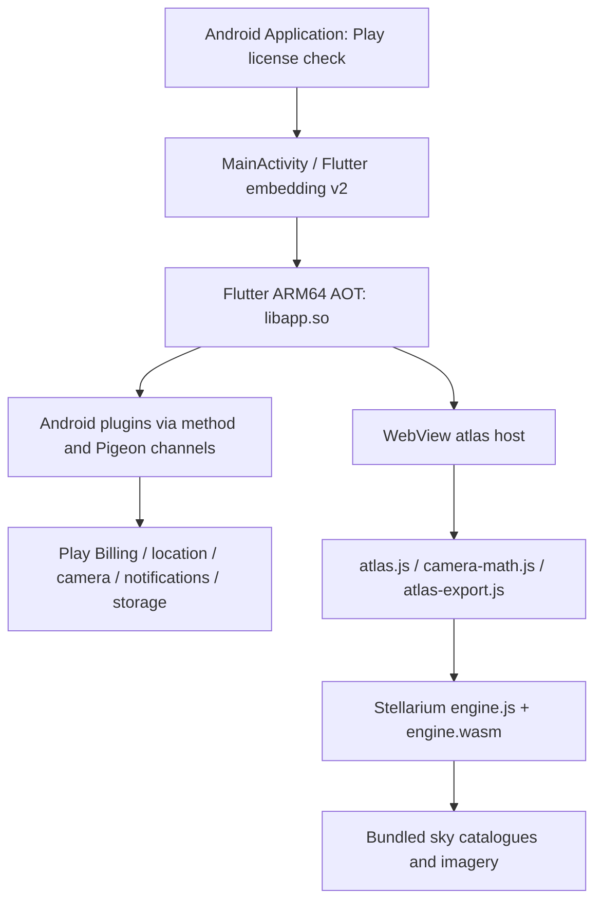

# SkyRadar 0.6.14: recovered architecture

Phase 1, static analysis, 2026-11-08 (Asia/Saigon). No app code was executed on a device or emulator. Confidence labels describe artifact evidence, not successful operation. **Confirmed** means directly present in bytes or a decoded instruction path; **probable** means an inference with incomplete linkage; **unverified** means evidence is insufficient.

## Evidence and package layout

Paths below are relative to `D:/Mod`. `analysis/unpacked/` contains extracted copies; `analysis/splits/` contains byte-identical APK entries from the backup. The original remains at the workspace root.

| Item | Confirmed value | Evidence |
|---|---|---|
| Input | `SkyRadar by Duy Chris_com.duychris.sky_radar_0.6.14.apks`, 62,408,133 bytes | `analysis/inventory.json`, `source_size` |
| SHA-256 | `07671a93371ebaa1e6aa31cf2bd8ab8d64c2ffd27c5087baa92be45abc0d2b84` | `analysis/inventory.json`, `source_sha256` |
| Identity | `com.duychris.sky_radar`, label `SkyRadar by Duy Chris` | `analysis/manifests/base.xml`, manifest `package` and application `label`; decoded readable counterpart `analysis/jadx/resources/AndroidManifest.xml` |
| Version | `0.6.14`, code `20433162` | Base manifest; `analysis/splits/meta.sai_v1.json` agrees |
| SDK | min 32, target 36, compile 36 | Base manifest `uses-sdk`, `compileSdkVersion` |
| Splits | `base.apk`, `split_config.arm64_v8a.apk`, `split_config.en.apk`, `split_config.ru.apk`, `split_config.vi.apk`, `split_config.xxhdpi.apk` | `analysis/inventory.json`, six APK entries; decoded manifests in `analysis/manifests/` |
| Required split types | `base__abi,base__density`; `com.android.vending.splits.required=true` | Base manifest |
| Launcher | `com.duychris.sky_radar.MainActivity` | Base manifest MAIN/LAUNCHER intent; `analysis/jadx/sources/com/duychris/sky_radar/MainActivity.java` |
| Startup application | `com.pairip.application.Application` | Base manifest; `analysis/jadx/sources/com/pairip/application/Application.java`, `attachBaseContext` |

The language splits describe Android resources; they do not establish Flutter UI language coverage. The Flutter asset tree has `assets/i18n/en.json` and Vietnamese text in JavaScript. `res/xml/splits0.xml` lists many possible language splits, but only the six APKs above are in this backup. **Confirmed** inventory; additional install variants are **unverified**.

## Layers

These layers are **confirmed** by the manifest, plugin registrations, native snapshot symbols and atlas scripts. App-specific data flow and remote entitlement dependencies are detailed in [entitlement_analysis.md](entitlement_analysis.md).

### Android and DEX

**Confirmed:** `analysis/unpacked/base/classes.dex` is DEX 037, 3,900,936 bytes, 4,104 defined classes, 23,975 method IDs and 24,326 strings. `classes2.dex` is DEX 037, 190,784 bytes, 131 classes, 1,357 method IDs and 1,059 strings. All defined classes in the second DEX are under `j$/`, including `j$/time` and `j$/util`. Evidence: `analysis/dex_inventory.json`, exact class lists. Thus the second DEX is desugared Java support; no app-owned entitlement class was identified there.

**Confirmed:** `MainActivity` is a small subclass of R8-renamed `s90`. `analysis/jadx/sources/defpackage/s90.java:370` registers `events.duychris.sky_radar/orientation`, `methods.duychris.sky_radar/orientation` and `methods.duychris.sky_radar/atlas-image` (lines 370–372 in this JADX output). Java class names such as `s90` are artifact names, not recovered original source names.

**Confirmed:** `analysis/jadx/sources/io/flutter/plugins/GeneratedPluginRegistrant.java`, `registerWith`, registers app links, CameraX, Firebase Core/Messaging, local notifications, splash, lifecycle, secure storage, geolocation, in-app purchases, JNI/JNI Flutter, MapLibre, package info, permission handler, sharing, shared preferences, Apple sign-in, URL launcher, WebView and WorkManager. Registrations establish bundled adapters; they do not prove every adapter is used in every session.

**Confirmed:** Play Billing's adapter is `defpackage.co0`, registered as `io.flutter.plugins.inapppurchase.InAppPurchasePlugin`; `co0.onAttachedToEngine` creates `g41` and calls `yn0.b`. `analysis/jadx/sources/defpackage/yn0.java`, method `b`, binds Pigeon channels for `launchBillingFlow`, `acknowledgePurchase`, `queryPurchasesAsync` and other operations. `analysis/unpacked/base/billing.properties` specifies `billing_client=9.1.0`. These are payment transport adapters, not proof of a Pro grant.

The initial JADX run reported 29 errors. A repeat returned exit code 0, but the generated tree still contains incomplete-method/error markers in 16 files. Treat generated Java as a reading aid; a successful tool exit is not proof of complete decompilation. `analysis/jadx_incomplete_methods.txt`, `analysis/jadx_status.json`, `analysis/jadx.log`, and the original DEX bytes are the audit references. `analysis/dex_string_references.json` records relevant `const-string` consumers with method code file offsets and instruction byte offsets.

### Flutter and native libraries

All seven native libraries are in `analysis/unpacked/split_config.arm64_v8a/lib/arm64-v8a/`. **Confirmed** by ELF headers and inventory:

| Library | Bytes | Role / confidence |
|---|---:|---|
| `libapp.so` | 11,404,176 | Flutter AOT snapshots, confirmed by `_kDartVmSnapshotData`, `_kDartIsolateSnapshotData`, `_kDartVmSnapshotInstructions`, `_kDartIsolateSnapshotInstructions` |
| `libflutter.so` | 11,581,856 | Flutter/Dart runtime, confirmed by Dart exports and version text |
| `libdartjni.so` | 124,776 | JNI bridge, probable role from name plus JNI plugin registration |
| `libdatastore_shared_counter.so` | 7,112 | DataStore counter support, probable role from name |
| `libimage_processing_util_jni.so` | 32,544 | Camera/image processing support, probable role from name and CameraX registration |
| `libmaplibre.so` | 10,851,472 | Native map engine, confirmed by MapLibre symbols/strings and registration |
| `libsurface_util_jni.so` | 4,896 | Surface JNI support, probable role from name |

`analysis/elf_inventory.json` records architecture, load segments, exported symbols, section locations and SHA-256 for every library. All are ELF64 AArch64. No other ABI is supplied.

**Confirmed:** `libapp.so` is a product AOT snapshot with compressed pointers. At file offset `0x354`, the snapshot compatibility hash is `ace654289f5abc240509fc941453ebc5`; following flags include `product no-code_comments no-dwarf_stack_traces_mode dedup_instructions ... arm64 android compressed-pointers`. Its build ID is `b7188509444cbe09f90d3cfa62b86c7d`. Exported isolate instruction data starts at virtual address/file offset `0x4d6a80`; VM instruction data starts at `0x4c0000`. Raw evidence: `analysis/unpacked/split_config.arm64_v8a/lib/arm64-v8a/libapp.so`; derived symbol records: `analysis/elf_inventory.json`.

**Confirmed:** `libflutter.so` at file offset `0x1edad9` contains `3.12.2 (stable) (Tue Jun 9 01:11:39 2026 -0700) on "android_arm64"`. This identifies Dart, not a Flutter framework release number. Exact Flutter framework version/revision remains **unverified**. Two 40-character hex strings in the engine are insufficient to attribute a framework version without further corroboration.

**Confirmed:** packaged `analysis/unpacked/base/kotlin-tooling-metadata.json` reports Gradle `9.3.1`, Kotlin plugin `2.4.0`, Java source/target `17`. **Unverified:** whether this metadata describes the top-level app build or a contributing dependency; the original Gradle files, lockfiles, Dart sources and keystore are absent from the archive inventory.

### WebView and sky engine

For this section `WEB` means `analysis/unpacked/base/assets/flutter_assets/assets/sky_atlas/`.

**Confirmed:** `WEB/index.html` loads the local atlas UI, CSS, camera math, export code and sky engine. `WEB/atlas.js:62` sends JSON messages through `window.SkyRadarBridge.postMessage`; `window.SkyRadarAtlas` is exposed at line 783 with `configure` and `setAccess`. Message types include boot, ready, upgrade, preferences, plans, image, site, GPS, follow, offline, retry and close. The host callback linkage is examined in the entitlement report.

**Confirmed local hosting:** `analysis/blutter/asm/sky_radar/data/atlas_asset_server.dart` binds an HTTP server to `InternetAddress.loopbackIPv4` at `0x7e2d50` and builds an `http://localhost:` URL at `0x7e4a24`. `analysis/blutter/asm/sky_radar/widgets/sky_atlas_view.dart`, `_start` (`0x7dd05c`), sets up the WebView and its `SkyRadarBridge` channel; `_configure` (`0x7eff68`) sends the host state. The architecture includes a loopback asset server, not only a file URL.

**Confirmed:** `WEB/engine-manifest.json` identifies Stellarium Web Engine commit `1162c9ef73cc94f4762dfbfd24c637190119ea93`, Emscripten `1.39.20`, and an upstream patch path `tools/patches/stellarium-mobile.patch`. Packaged SHA-256 values for `engine.js`, `engine.wasm` and `skydata.zip` all match the extracted bytes (`analysis/asset_inventory.json`, `engine_checksums`). The patch source itself is absent from this backup.

**Confirmed:** `engine.wasm` has WebAssembly version-1 magic/header. Local resources include `skydata.zip`, `dss-base.zip`, target catalogues, H-alpha images/manifests, nebula images/manifests and a font. See `analysis/asset_inventory.json` for sizes, hashes and internal ZIP member names. This is an offline data pack; it does not establish complete offline operation of the application.

**Confirmed:** `WEB/NOTICE.txt` and `WEB/LICENSE.txt` label the Stellarium engine/mobile patch AGPL-3.0 and record survey and imagery attributions. These are recovered build/distribution inputs; legal compliance and source availability have not been adjudicated in Phase 1.

**Confirmed:** `analysis/jadx/resources/res/xml/atlas_network_security.xml` permits cleartext only for `localhost` and `127.0.0.1`; its base policy forbids cleartext. The app manifest sets `usesCleartextTraffic=false`, `extractNativeLibs=false`, `allowBackup=false` and disables Impeller via `io.flutter.embedding.android.EnableImpeller=false`.

## Recovery limits

This is an architectural reconstruction, not recovered buildable Flutter source. Symbolic AOT disassembly can establish specific branches and callers, but cannot restore comments, exact types, project layout, dependency constraints or build flags beyond evidence present in the package. Backend implementations, database policies and live purchase state are outside this artifact. No feature is claimed to be unlocked or functionally validated.
