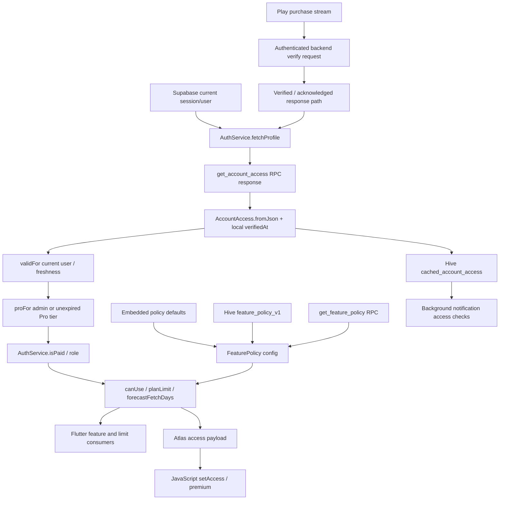

# Entitlement analysis: SkyRadar 0.6.14

Phase 1 static analysis only. **Confirmed** describes instructions/data present in this artifact; **probable** describes an inference; **unverified** describes missing evidence. No functional unlock, valid purchase, live account state or backend behavior has been tested.

## Evidence notation

All paths are relative to `D:/Mod`. In the tables below, `AOT/` means `analysis/blutter/asm/sky_radar/` and `WEB/` means `analysis/unpacked/base/assets/flutter_assets/assets/sky_atlas/`.

Files under `AOT/` are symbolic ARM64 disassembly produced by Blutter, despite their `.dart` extension. They are **not recovered Dart source**. Hex instruction addresses are virtual addresses in `analysis/unpacked/split_config.arm64_v8a/lib/arm64-v8a/libapp.so`. Its relevant load segments have equal file offsets and virtual addresses, so the cited addresses also locate these bytes in this particular file. ASLR addresses printed by the analysis tool are not device addresses. `analysis/native_verified_sites.json` independently checks nine important direct calls and four instruction ranges with Capstone. `analysis/aot_methods.json` and `analysis/aot_calls.json` provide the complete generated app-method and direct-call index.

## Confirmed entitlement graph

Arrows represent statically identified client paths. They do not establish what a server actually returns or enforces.

## 1. Account-access source, parsing and lifetime

| Finding | Classification | Exact evidence |
|---|---|---|
| Foreground account access is fetched through Supabase RPC `get_account_access` | Confirmed | `AOT/data/auth_service.dart`, `AuthService.fetchProfile` at `0x82ddbc`; RPC name at `0x82dfb8`, call at `0x82dfc8` |
| Profile display data is queried separately from `profiles` | Confirmed | Same function: `profiles` at `0x82dee8`, selection `id, role, display_name, avatar_url, created_at` at `0x82def8`, ID filter and `maybeSingle` through `0x82df18` |
| Account response is parsed with the current user's ID and a locally supplied verification time | Confirmed | Same function: DateTime construction at `0x82e11c`, `verifiedAt` named argument and `AccountAccess.fromJson` at `0x82e154`/`0x82e15c`; stored to static field `0x10a0` at `0x82e16c` |
| Stale in-flight results are checked against a request generation and current user before applying | Confirmed | `fetchProfile`: generation increment at `0x82ddf4`; comparisons after awaits at `0x82df54` and `0x82e004`, user comparisons through `0x82e048` |
| A missing user clears access; the exception path clears access for the matching active request/user | Confirmed | `fetchProfile` writes null at `0x82dea0` and `0x82e1e8`; `signOut` clears it immediately at `0x832734` and calls `FavoritesService.clearOnSignOut` |
| Legacy `cached_role` alone is not the foreground Pro authority in these getters | Confirmed for recovered getters | `AuthService.isPaid` at `0x721664` uses `AccountAccess.proFor`; `role` at `0x721ad4` uses `AccountAccess.validFor`; `refreshRole` deletes `cached_role` at `0x82dd08` |

`AccountAccess.fromJson` (`AOT/data/account_access.dart`, `0x82e278`) validates `version == 1` and matching `user_id`, permits roles `user`/`admin` and tiers `free`/`pro`, rejects a non-null unparsable expiry, and requires a parseable `verified_at` unless an explicit `verifiedAt` is supplied. **Confirmed** at `0x82e2e0`–`0x82e5b4`. Be careful with tagged integers: the raw immediate `2` in the version comparison represents Dart Smi `1`, not schema version 2.

The object's recovered field layout is **confirmed** by `fromJson` stores and `toJson` (`0x721838`):

| Compressed-object field offset in disassembly | Meaning |
|---|---|
| `0x7` | user ID |
| `0xb` | role |
| `0xf` | tier |
| `0x13` | source |
| `0x17` | optional expiry |
| `0x1b` | verification time |

`validFor` (`0x721998`) checks the requested user ID against the object's user ID. It rejects a verification time more than five minutes ahead of local time, and requires age strictly less than 24 hours. **Confirmed**: `0x721a38`–`0x721ab0`; durations in `analysis/blutter/pp.txt`, `[pp+0x21d0]` = `0x11e1a300` microseconds (300 seconds) and `[pp+0x448]` = `0x141dd76000` microseconds (86,400 seconds). These are client clock/freshness checks; they are not a cryptographic proof of subscription validity.

`proFor` (`0x7216ec`) first calls `validFor`. A valid `admin` role passes. Otherwise tier must be `pro` and expiry must be absent or strictly after now. **Confirmed** at `0x721748`, role comparison `0x721764`, tier comparison `0x721794`, expiry branch `0x7217b4`–`0x7217d8`. An absent expiry is therefore accepted by this **client** predicate; the server's policy for issuing such an object is **unverified**.

`AuthService.isPaid` (`0x721664`) returns true only when the cached in-memory object's `proFor(currentUser.id)` returns true. `AuthService.role` (`0x721ad4`) exposes `admin` only for a valid admin access object and otherwise returns `free`; `AuthService.tier` (`0x746ee0`) returns guest/free/pro for presentation. These are distinct values, not interchangeable role strings.

## 2. Persisted access and background consumers

**Confirmed:** `AuthService.refreshRole` (`AOT/data/auth_service.dart:627`, `0x82dc00`) refreshes policy, fetches profile/access, then writes `AccountAccess.toJson()` to Hive box `settings`, key `cached_account_access`, only if `validFor(currentUser.id)` passes; otherwise it deletes that key. It also deletes `cached_role`. Evidence: `0x82dc24`, `0x82dc34`, `0x82dcbc`, `0x82dcd4`, `0x82dcf0`, `0x82dd08`.

**Confirmed background reads:**

| Consumer | Source → check → use |
|---|---|
| Daily notifications | `AOT/data/daily_noti_service.dart`, `DailyNotiService.run` (`0x8f1400`): read `cached_account_access` at `0x8f1710`, parse with `AccountAccess.fromJson` at `0x8f1884`, require `proFor` at `0x8f18a8`, then process favorites |
| Target opportunity alerts | `AOT/data/opportunity_alert_service.dart`, `_maybeTargets` (`0x8ee6f0`): read key at `0x8ee7bc`, parse at `0x8ee930`, consult foreground `isPaid` at `0x8ee944` and cached `proFor` at `0x8ee96c`; target policy lookup occurs in `targetAlertLines` at `0x8eed68`/`0x8eed70` |
| Sign-out cleanup | `AOT/data/favorites_service.dart`, `clearOnSignOut` (`0x832820`) delegates scope preparation; settings-key classification closure at `0x7514e8` includes `cached_account_access` and `cached_role` |

The traced cache is a Hive map, not a recovered signed purchase receipt. **Unverified:** filesystem encryption for that box and all possible restore paths. No foreground startup grant from `cached_role` was found in the traced code. Do not infer that editing one settings value would consistently enable all consumers.

## 3. Feature policy is a separate input

**Confirmed:** `FeaturePolicy.defaults` (`AOT/data/feature_policy.dart`, `0x721610`) JSON-decodes the embedded policy at `libapp.so` file offset `0xc616c`. The exact JSON is reproduced at `analysis/embedded_feature_policy.json`, with its origin recorded in `analysis/asset_inventory.json`.

| Feature keys | Embedded mode |
|---|---|
| `planner`, `polar`, `virtual_sky`, `target_gc`, `target_moon` | `free` |
| `halpha`, `framing`, `target_planets`, `target_trails`, `target_dso`, `target_ray`, `analysis`, `route` | `pro` |
| `contributions`, `ai` | `off` |

These are **confirmed defaults**, not a claim about the live remote configuration. Older localization phrases saying all planner/tracker tools are Pro conflict with these defaults and must not override the traced policy.

`FeaturePolicy._refresh` (`0x82ecb8`) first tries Hive `settings/feature_policy_v1` (`0x82ed28`), then calls Supabase `get_feature_policy` (`0x82ed7c`, RPC at `0x82ed8c`). Successfully applied responses are cached at `0x82ee0c`. `apply` (`0x82ee44`) validates a response envelope containing integer `revision` and `config`, calls `valid` (`0x82f168`) and updates `_config`/revision/`changes` on acceptance. **Confirmed** structure; the exact ordering semantics of the dynamically dispatched revision comparison are **probable**, not relied on here. Failed/invalid updates do not establish new grants.

`valid` checks schema, feature/limit maps and allowed values. Normal features permit off/free/pro; `ai` has an off/admin branch (`0x82f58c`–`0x82f644`). **Confirmed** validation code; no live accepted policy was obtained.

`AuthService.canUse(feature)` (`0x743fac`) derives admin/pro/free from account access, then calls `FeaturePolicy.allows(feature, role)` at `0x744000`. `allows` (`0x744018`) allows free features to all roles, Pro features to pro/admin, and admin mode only to admin; off/unrecognized modes fail. `mode` (`0x74412c`) defaults a missing feature key to `off`, while an empty key returns `free`. **Confirmed** branches. Pro does not make an off feature available.

### Numeric limits and forecast distinction

| Limit | Free default | Pro default | Confirmed consuming code |
|---|---:|---:|---|
| `forecast_days` | 3 | 7 | `AOT/screens/map_screen.dart`, forecast UI build call `0xa6dd68`; `AOT/screens/scan_screen.dart`, `_runScan` call `0x771cf0` |
| `favorites` | 3 | null / no cap | `AOT/data/favorites_service.dart`, `atFreeLimit` at `0x75204c`, limit reads `0x75206c`/`0x75208c`; `map_screen.dart` save action checks it at `0x74aa10` |
| `scan_radius_km` | 100 | 500 | `AOT/screens/scan_screen.dart`, `_runScan` call `0x771b18`; subsequent radius validation in the same method |

**Confirmed:** `AuthService.planLimit` (`0x752620`) chooses admin/pro/free and calls `FeaturePolicy.limit` (`0x721434`). Pro/admin generally use the Pro limit map, except admin `forecast_days` returns **14**. At `0x721478` the raw register value is `0x1c`, a tagged Smi 14; Blutter's label `r0 = 28` is the raw immediate and must not be read as 28 days.

**Confirmed and material:** network-fetch horizon differs from display access. `AuthService.forecastFetchDays` (`0x721358`) calls `FeaturePolicy.fetchDays` (`0x7213bc`), which computes `clamp((limit ?? 7) + 1, 8, 15)` after unboxing the limit. The default free and Pro cases both fetch 8 days; admin fetches 15. Calls are present in `OpenMeteoClient.fetchRaw` (`AOT/data/open_meteo_client.dart`, `0x7260c8`) and `SanMayValley.fetch` (`AOT/data/san_may_valley.dart`, `0x71f928`). Thus receipt of an eight-day response alone would not prove Pro UI access or a missing server check.

## 4. Concrete feature consumers

All rows below are **confirmed client call sites**. They establish gates/consumers, not functioning feature outputs.

| Function / file | Entitlement or policy use |
|---|---|
| `AOT/screens/map_screen.dart`, `_gateFeature` | `canUse` at `0x7452d8`; mode at `0x7452f4`; central tool-entry decision |
| Same file, `_toolCard` | mode lookups `0x744c1c`/`0x744ddc`; card visibility/presentation |
| Same file, `_policyUpdated` | reevaluates four `canUse` checks at `0x8a1f04`, `0x8a1f2c`, `0x8a1f54`, `0x8a1f78` |
| Same file, `_showTargetRay` | `canUse` at `0x743aec` |
| `AOT/widgets/side_panel.dart`, `_buildBurnSection`, `_buildAstroSection` | access calls `0x92858c` and `0x92bd84`; analysis feature restriction |
| `AOT/widgets/target_picker.dart`, `_locked` | target key at `0x854dc0`, access at `0x854dc8` |
| `AOT/data/scan_service.dart`, worker closure | target key at `0x77388c`, access at `0x773894`; gate also exists during scanning |
| `AOT/data/target_ray.dart`, `ensure` | target key at `0x935730`, access at `0x935738` |
| `AOT/widgets/sky_atlas_view.dart`, `_atlasAccess` | calls `canUse('halpha')` at `0x7f0aa0`, `canUse('framing')` at `0x7f0ac4`; includes policy modes at `0x7f0b04`/`0x7f0b48` |

Target-key classification is in `FeaturePolicy.targetKey` (`0x7750e4`); defaults and target metadata together determine which target types are restricted. Route is Pro in the embedded policy, but its current service-side access rules remain **unverified**. Existing localization text mentions route upgrades/internal admin testing; those strings alone do not establish the active route deployment state.

## 5. Flutter → JavaScript atlas trace

**Confirmed full client chain:** `_SkyAtlasViewState._atlasAccess` (`0x7f0a64`) creates a map with `halpha`, `framing` and `modes`. `_configure` (`0x7eff68`) inserts it under `access` alongside site/preferences/plans and invokes `_send('configure', payload)` at `0x7f01a8`. `_send` (`0x57073c`) JSON-encodes the argument, constructs `window.SkyRadarAtlas?.<method>(...);` and calls `runJavaScript` at `0x570834`.

The host is not a one-time-only access setter: `initState` starts a periodic timer (`0x8ad324`); its closure (`0x8ad3a0`) reevaluates `_atlasAccess` (`0x8ad3d0`) and sends changed values through `setAccess` (`0x8ad44c`/`0x8ad454`). Exact timer frequency is not needed for the access conclusion.

| JavaScript location | Confirmed behavior |
|---|---|
| `WEB/atlas.js:8`, `premium` at line 9 | Both flags initially false; returns true for the corresponding flag, otherwise shows a Pro message, sends `upgrade`, returns false |
| `setAccess`, lines 13–29 | Accepts strict booleans `framing`/`halpha` or compatibility `pro`; disables H-alpha/camera tools, cancels exports and closes relevant dialogs on access loss; hides buttons whose mode is off |
| `configure`, lines 84–98 | Uses host `config.access`; restored preferences/plans do not supply entitlement; camera and H-alpha preferences are bounded by current access |
| `renderExport`, line 425; `saveExport`, line 461 | Both begin with a `premium()` check |
| UI capture listener, lines 611–616 | Blocks restricted H-alpha, frame, plans, plan export, frame image, save-plan and image render/save/share button events |
| Restore path, line 835 | Restores saved preferences with the current access flags instead of accepting saved plan privileges |
| `WEB/atlas-export.js`, `render` at line 9 | Rendering helper receives engine/camera and a cancellation check; access decisions occur in its atlas caller |

`atlas.js:475` sends image chunks via `SkyRadarBridge`. The Flutter `_onMessage` method (`0x7f0e74`) dispatches messages, and `_receiveImage` (`0x7f1aec`) assembles/exports images through native/share adapters. The `upgrade` branch consults `isPaid` at `0x7f1148`. These are local UI/bridge paths, not server authorization. No JS was modified or executed during this phase.

## 6. Purchase, verification and authorization boundaries

**Confirmed Android payment path:** `GeneratedPluginRegistrant.registerWith` → `defpackage.co0.onAttachedToEngine` → `g41` and `yn0.b` Pigeon handlers → platform BillingClient. Evidence under `analysis/jadx/sources/`, plus `billing.properties` version 9.1.0. Purchase results flow back to Flutter's `InAppPurchaseAndroidPlatform`; relevant wrappers are disassembled under `analysis/blutter/asm/in_app_purchase_android/`.

**Confirmed app payment path:** `PlayBillingService.start` (`AOT/data/play_billing_service.dart`, `0x8b576c`) subscribes to purchases and queues processing through closures at `0x8b5a88`/`0x8b5b6c`. `_process` (`0x8b5c80`) distinguishes pending/error/canceled versus purchased/restored results, checks account context, hashes the retained token for deduplication, and invokes backend `verify` at `0x8b61a8`.

`HttpPlayBillingBackend` (`0x82dab8`) constructs a Dio client with base URL `https://app.duychris.com/api/billing/google-play` (`0x82dadc`). These **confirmed request definitions were not called**:

| Method / address | Client request |
|---|---|
| `config`, `0x8438f8` | GET `/config`; `PlayBillingService.load` (`0x84269c`) checks `enabled` and requires `testOnly == false` before loading offers |
| `accountContext`, `0x8440ec` | Authenticated GET `/context`, reads `obfuscatedAccountId` |
| `verify`, `0x8b6c54` | Authenticated POST `/verify`, JSON `purchaseToken` field (`0x8b6c9c`) |

`AuthService.requestHeaders` (`AOT/data/auth_service.dart`, `0x71bde4`) adds `Authorization: Bearer <session access token>` for an unexpired session, otherwise returns an empty map. **Confirmed** at `0x71be00`–`0x71beb0`. The same helper is called by `AssessClient._post` at `0x71bc3c`, demonstrating authenticated data requests beyond billing; per-endpoint enforcement remains unverified.

`_process` requires response `verified == true` (`0x8b61cc`–`0x8b6208`), otherwise throws `Verification not confirmed` (`0x8b68b8`). It consumes `active`, `state` and `acknowledged`, refreshes account access via `AuthService.refreshRole` at `0x8b6520`, and completes the platform purchase where required at `0x8b658c`. **Confirmed:** the verified response path triggers a fresh account-access fetch; it does not directly write a permanent local `isPro=true` field. **Unverified:** the verifier's implementation, actual Google API validation, acknowledgment behavior, subscription reconciliation and database update rules.

`playAccountId` (`0x5db67c`) hashes `skyradar:play:v1:` plus account identifier using SHA-256; `_process` compares account context at `0x8b5d88`/`0x8b60dc`. This is **confirmed client account binding**, not a payment receipt or proof of a server-side binding guarantee.

Candidate offer strings `skyradar_pro`, `pro_monthly`, `pro_half_year`, `pro_yearly` are **confirmed constants** at `libapp.so` file offsets `0x11409f`, `0x569f0`, `0x772c2`, `0xa1605`. Exact currently available Play products, prices and plans are **unverified** because the loader also consumes remote configuration and product queries.

### Separate Google Play application license

**Confirmed:** `analysis/jadx/sources/com/pairip/application/Application.java`, `attachBaseContext`, calls `LicenseClient.checkLicense` before the superclass call. `LicenseClient.java` binds Play licensing services, contains the original package name and retry/shutdown behavior. `LicenseResponseHelper.java`, `validateResponse`, checks JWS algorithm RS256, verifies `SHA256withRSA` and compares the response package name. This protects app acquisition/startup in the recovered artifact. No cross-call to the app's account-access model was identified in the traced path; treating it as the Pro subscription authority is unsupported.

## 7. What is local, remote-dependent, and still unknown

| Boundary | Classification |
|---|---|
| Feature cards, target gates, numeric caps, atlas flags and export entry points | Confirmed client-side decisions |
| Account object issued by `get_account_access`, configurable policy RPC, billing verifier response | Confirmed remote inputs expected by client |
| Actual purchase validation with Google and issuance/revocation of account entitlements | Unverified server implementation |
| Authorization on weather/assessment/route APIs and Supabase tables/RPCs | Unverified enforcement; presence of a bearer header does not prove enforcement |
| Production RLS, subscription tables, admin privileges, receipt validation and credentials | Not recovered; unverified |
| Localization strings advertising staging Pro previews or free upgrades | Confirmed text in `analysis/unpacked/base/assets/flutter_assets/assets/i18n/en.json`; reachability as a working developer switch is unverified |
| A single universal “Pro switch” or one patch that unlocks every feature | Unverified and contradicted as a useful model by separate access, policy, numeric-limit and backend inputs |

The next phase should use an isolated source-level test provider plus policy fixtures and staging/mock services, as proposed in [rebuild_plan.md](rebuild_plan.md). This phase made no backend requests and changed no account/subscription state. No feature is claimed unlocked.
